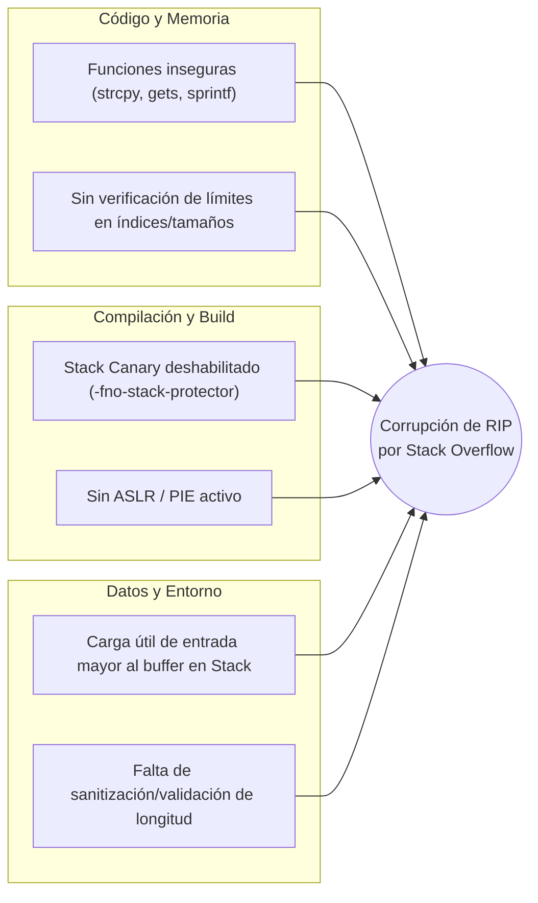
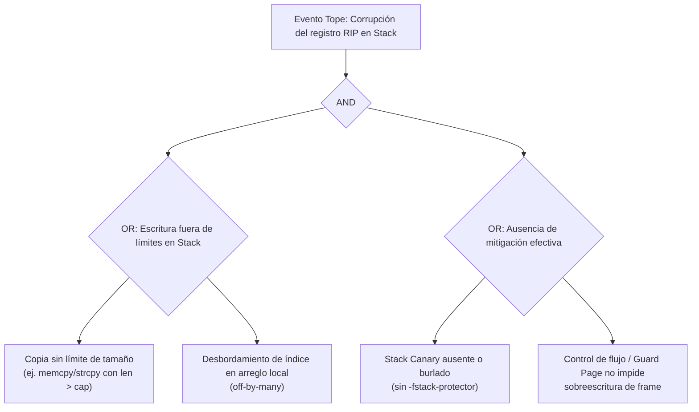

# Análisis de Árbol de Fallos (FTA) e Ishikawa: Corrupción de `RIP` por Buffer Overflow en Stack

## 1. Diagrama de Ishikawa (Espina de Pescado)

## 2. Árbol de Fallos (FTA — Compuertas `AND` / `OR`)

En una arquitectura x86_64 con pila que crece hacia direcciones bajas, sobrescribir la dirección de retorno (`RIP` guardado en el marco de pila) requiere que se escriba más allá del buffer local (`OR` entre fallos de escritura/longitud) **Y** que no se detenga antes de alcanzar `RIP` (`AND` con ausencia de mitigaciones/controles efectivos).

